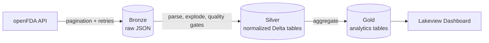

# FDA Adverse Event Analytics Pipeline


A batch ETL pipeline that ingests drug adverse event reports from the **openFDA API**, processes them through a **medallion architecture** (Bronze → Silver → Gold), and publishes analytics through a **Lakeview (AI/BI) dashboard**. Built on Databricks with Delta Lake and Unity Catalog, and orchestrated with a Declarative Automation Bundle.

**[View the Live Dashboard](https://dbc-a4bd6c77-a376.cloud.databricks.com/dashboardsv3/01f1c1f6d2611bda9a1ade2a711c3ed2/published?o=7474648475439044)**

<!-- Add a screenshot: save it as docs/dashboard.png and uncomment the line below -->
<!--  -->

## Overview

| Metric | Value |
|---|---|
| Reports analyzed | 5,000 |
| Unique drugs | 3,293 |
| Countries | 65 |
| Unique reactions | 2,123 |
| Period covered | 2008 – 2015 |

> **Disclaimer:** FAERS data is based on voluntary reporting. Report counts do not establish causation or relative drug safety.

## Architecture



| Layer | Notebook | Responsibility |
|---|---|---|
| **Bronze** | `01_bronze_ingest` | Fetches raw JSON from the openFDA API with pagination (HTTP 404 = clean end of results), transient-only retries (429/5xx) with exponential backoff, request timeouts, streaming writes, and API-key redaction in every logged or raised message. Each run is tagged with a unique `run_id` timestamp, so re-runs append rather than overwrite. |
| **Silver** | `02_silver_transform` | Parses JSON into three normalized Delta tables with explicit grains, normalizes patient age from multiple NCIT unit codes, keeps only the latest `safetyreportversion` of each report, synchronizes drug/reaction child rows via `whenNotMatchedBySourceDelete`, and enforces hard quality gates. |
| **Gold** | `03_gold_aggregate` | Pre-aggregates by country, drug, and reaction over time using `countDistinct(report_id)` to avoid inflated counts from join fan-out; reports with unparseable dates are excluded from the monthly trend and logged. Tables include Unity Catalog comments and FAERS disclaimers. |

## Data Model

**Silver** (normalized)

| Table | Grain |
|---|---|
| `fda_reports` | One row per report (`report_id`) |
| `fda_report_drugs` | One row per normalized drug per report (`report_id`, `drug_name`); role conflicts resolve to Suspect (1), then Concomitant (2), then Interacting (3) |
| `fda_report_reactions` | One row per reaction per report (`report_id`, `adverse_reaction`) |

**Gold** (pre-aggregated)

| Table | Description |
|---|---|
| `fda_reports_by_country` | Unique reports by country |
| `fda_top_drugs` | Drug rankings with average patient age |
| `fda_reactions_over_time` | Monthly reaction trends |

## Engineering Highlights

- **Idempotent by design.** Each Delta table MERGE is atomic on its own; the three Silver MERGEs are not one cross-table transaction. The Silver task is retried and can be safely replayed from the full Bronze history to converge after a partial failure. Bronze preserves every ingestion run.
- **Version-aware upserts.** openFDA reports carry `safetyreportversion`; silver keeps only the highest version of each report, and only a strictly newer version can update an existing report; equal versions are immutable, and conflicting same-version payloads fail before any write.
- **Child-table sync.** When an updated report version drops a drug or reaction, the child MERGE (`whenNotMatchedBySourceDelete`) removes the stale target row. This operation relies on Silver reading the complete append-only Bronze history on every run.
- **Raw and table-level quality checks.** Before any Silver write, the pipeline validates raw report IDs and rejects conflicting payloads that share the same report ID/version. Blank drug/reaction terms are counted and warned about before extraction filters them. After the MERGEs, table-level checks verify grain and referential integrity; a failure blocks Gold.
- **Soft warnings.** Null dates, invalid sex/age values, and blank names are logged as warnings without blocking execution.
- **Secret hygiene.** openFDA only accepts the API key as a URL query parameter, so `requests` exception messages embed it. Bronze redacts every logged or raised message and never re-raises the original exception (`raise ... from None`).
- **Resilient ingestion.** HTTP 404 past the first page is treated as a clean end-of-pagination; only transient errors (429, 5xx, network) are retried; permanent 4xx fails fast. Without an API key the pipeline falls back to unauthenticated requests (500 records per page instead of 1,000).
- **Tested.** Pytest covers bronze API error paths and key redaction, silver normalization/version selection/raw quality gates/Delta MERGE semantics, and gold aggregation fan-out safety. CI runs lint and the local Spark/Delta integration suite.
- **Governed tables.** Unity Catalog provides governance and lineage, with documented Gold tables.

## Interview Walkthrough

**60-second project explanation**

> I built a batch data pipeline using openFDA adverse-event reports. Bronze stores the original API responses as append-only JSON, with pagination, retries and secret redaction. Silver uses PySpark to normalize reports, drugs and reactions into separate Delta tables, preserving their grains and avoiding a drug-by-reaction Cartesian join. I added report-version handling, raw-input quality checks and Delta MERGE operations so reruns are repeatable. Gold produces dashboard-ready aggregates, and GitHub Actions runs lint plus local Spark/Delta tests. The main design trade-off is that each Delta table write is atomic, but the three-table Silver update is not a single transaction; the job retries and replays the full Bronze history to converge after a partial failure.

**Design decisions to be ready to explain**

- **Why medallion architecture?** Bronze preserves source evidence; Silver owns cleansing, entity grains and integrity; Gold serves analytics without repeating transformations.
- **Why separate drug and reaction tables?** Exploding both arrays in one transformation would multiply rows and inflate counts. Separate child tables retain each relationship to the report without implying a drug caused a specific reaction.
- **How are report updates handled?** Select the highest safetyreportversion; reject conflicting payloads for the same ID/version; update an existing report only when the incoming version is strictly newer.
- **How do reruns work?** Bronze is append-only. Silver reads the complete Bronze history, deduplicates equivalent records and re-applies idempotent Delta MERGEs. Child-table sync removes rows absent from the latest full-history source.
- **What is not transactional?** A Delta MERGE is atomic per table, not across reports, drugs and reactions. The Silver task retries and a full-history replay repairs a partial run. This is an explicit recovery strategy, not a claim of cross-table atomicity.
- **What do the metrics mean?** They count submitted reports, not confirmed adverse effects or causal evidence. FAERS is a spontaneous-reporting system and is subject to reporting bias.

**Known scope and limitations**

- This is a batch portfolio project, not a production pharmacovigilance system.
- The current ingestion is deliberately capped at 5,000 records per run; expanding historical coverage and incremental ingestion are future work.
- The local Spark/Delta suite validates transformation and MERGE behavior, but it does not prove that the complete pipeline has run successfully in every Databricks workspace configuration.
- Databricks bundle validation in CI requires workspace credentials; without them that CI job reports a skip.
## Dashboard

A single-page overview of the adverse event data:

- **KPI counters:** total reports, unique drugs, countries, and reactions
- **Top 10 drugs by report volume** (LETAIRIS leads with 1,278 reports)
- **Top 10 countries by reports** (US leads with 3,820)
- **Top 15 adverse reactions** (most common: Dyspnoea, Type 2 Diabetes Mellitus, Drug Ineffective)
- **Patient sex distribution** (64% female, 29% male, 7% unknown)
- **Monthly report volume**, 2008 – 2015
- **Age group distribution** (60–74 is the largest group, with 1,134 reports)
- **Top 10 drugs with average patient age**

## Getting Started

**Requirements**

- Databricks workspace with Unity Catalog
- Unity Catalog Volume: `workspace.default.fda_data`
- *(Optional)* openFDA API key set as the `FDA_API_KEY` environment variable

**Option 1: Run manually.** Clone the repo into a Databricks Git folder and run the notebooks in order: Bronze → Silver → Gold.

**Option 2: Deploy as a job.** The bundle configures daily execution:

```bash
databricks bundle deploy
```

**Local development & tests.** The test suite runs Spark locally — no Databricks workspace needed:

```bash
pip install -r requirements-dev.txt   # pytest, flake8, pyspark, delta-spark
pytest -v                             # JDK 17 required for the Spark tests
flake8 notebooks/ tests/               # max-line-length 120, no error codes ignored
```

Tests extract the transformation functions from the notebook sources via AST (so no Databricks session is needed) and run them against a local Spark + Delta session. Coverage includes raw-input rejection before filters, conflicting report-version detection, deterministic drug-role resolution, version-aware MERGE, child-table synchronization, and gold aggregation fan-out safety.

**CI (GitHub Actions)** runs three jobs on every push and pull request: flake8 lint over notebooks and tests, the pytest suite on Ubuntu with Temurin JDK 17, and `databricks bundle validate` (skipped with a notice when workspace credentials are not configured).

## Tech Stack

| Component | Technology |
|---|---|
| Compute & storage | Databricks (serverless), Delta Lake |
| Processing | PySpark |
| Governance | Unity Catalog |
| Orchestration | Declarative Automation Bundles |
| Source | openFDA API |
| Visualization | Databricks AI/BI (Lakeview) |

## Roadmap

- [x] Automated tests for the transform logic (pytest, local Spark + Delta)
- [x] CI with GitHub Actions (lint, tests, bundle validation)
- [ ] Orchestrate with Apache Airflow as an alternative to bundles
- [ ] Expand ingestion beyond the current 5,000-report sample

## Author

**Nicolás Romero**, Junior Data Engineer
[LinkedIn](https://www.linkedin.com/in/nicolasromero-data) · [GitHub](https://github.com/nicodatas)
