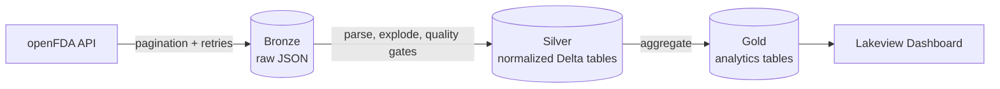

# FDA Adverse Event Analytics Pipeline


A batch ETL pipeline that ingests drug adverse event reports from the **openFDA API**, processes them through a **medallion architecture** (Bronze → Silver → Gold), and publishes analytics through a **Lakeview (AI/BI) dashboard**. Built on Databricks with Delta Lake and Unity Catalog, and orchestrated with a Declarative Automation Bundle.

**[View the Live Dashboard](https://dbc-a4bd6c77-a376.cloud.databricks.com/dashboardsv3/01f1c1f6d2611bda9a1ade2a711c3ed2/published?o=7474648475439044)**

<!-- Add a screenshot: save it as docs/dashboard.png and uncomment the line below -->
<!--  -->

## Overview

| Metric | Value |
|---|---|
| Reports analyzed | 5,000 |
| Unique drugs | 3,293 |
| Countries | 65 |
| Unique reactions | 2,123 |
| Period covered | 2008 – 2015 |

> **Disclaimer:** FAERS data is based on voluntary reporting. Report counts do not establish causation or relative drug safety.

## Architecture



| Layer | Notebook | Responsibility |
|---|---|---|
| **Bronze** | `01_bronze_ingest` | Fetches raw JSON from the openFDA API with pagination (HTTP 404 = clean end of results), transient-only retries (429/5xx) with exponential backoff, request timeouts, streaming writes, and API-key redaction in every logged or raised message. Each run is tagged with a unique `run_id` timestamp, so re-runs append rather than overwrite. |
| **Silver** | `02_silver_transform` | Parses JSON into three normalized Delta tables with explicit grains, normalizes patient age from multiple NCIT unit codes, keeps only the latest `safetyreportversion` of each report, synchronizes drug/reaction child rows via `whenNotMatchedBySourceDelete`, and enforces hard quality gates. |
| **Gold** | `03_gold_aggregate` | Pre-aggregates by country, drug, and reaction over time using `countDistinct(report_id)` to avoid inflated counts from join fan-out; reports with unparseable dates are excluded from the monthly trend and logged. Tables include Unity Catalog comments and FAERS disclaimers. |

## Data Model

**Silver** (normalized)

| Table | Grain |
|---|---|
| `fda_reports` | One row per report (`report_id`) |
| `fda_report_drugs` | One row per drug per report (`report_id`, `drug_name`) |
| `fda_report_reactions` | One row per reaction per report (`report_id`, `adverse_reaction`) |

**Gold** (pre-aggregated)

| Table | Description |
|---|---|
| `fda_reports_by_country` | Unique reports by country |
| `fda_top_drugs` | Drug rankings with average patient age |
| `fda_reactions_over_time` | Monthly reaction trends |

## Engineering Highlights

- **Idempotent by design.** Silver uses Delta `MERGE` on composite keys with source-side deduplication, so re-running on the same data is safe. Bronze preserves every ingestion run.
- **Version-aware upserts.** openFDA reports carry `safetyreportversion`; silver keeps only the highest version of each report, and the guarded MERGE update condition (`source.report_version >= coalesce(target.report_version, 0)`) prevents a late-arriving older version from overwriting a newer row.
- **Child-table sync.** When an updated report version drops a drug or reaction, the child MERGE (`whenNotMatchedBySourceDelete`) removes the stale target row — orphaned child rows cannot accumulate.
- **Hard quality gates.** Silver fails fast on null or duplicate `report_id` (grain violation) and on orphan drug/reaction records (referential integrity). A failure raises a `RuntimeError` and skips all downstream tasks (`ALL_SUCCESS` dependency in the job).
- **Soft warnings.** Null dates, invalid sex/age values, and blank names are logged as warnings without blocking execution.
- **Secret hygiene.** openFDA only accepts the API key as a URL query parameter, so `requests` exception messages embed it. Bronze redacts every logged or raised message and never re-raises the original exception (`raise ... from None`).
- **Resilient ingestion.** HTTP 404 past the first page is treated as a clean end-of-pagination; only transient errors (429, 5xx, network) are retried; permanent 4xx fails fast. Without an API key the pipeline falls back to unauthenticated requests (500 records per page instead of 1,000).
- **Tested.** A suite of 50 tests (pure Python plus local Spark/Delta integration) covers bronze API error paths and key redaction, silver normalization/versioning/MERGE semantics/quality gates, and gold aggregation fan-out safety.
- **Governed tables.** Unity Catalog provides governance and lineage, with documented Gold tables.

## Dashboard

A single-page overview of the adverse event data:

- **KPI counters:** total reports, unique drugs, countries, and reactions
- **Top 10 drugs by report volume** (LETAIRIS leads with 1,278 reports)
- **Top 10 countries by reports** (US leads with 3,820)
- **Top 15 adverse reactions** (most common: Dyspnoea, Type 2 Diabetes Mellitus, Drug Ineffective)
- **Patient sex distribution** (64% female, 29% male, 7% unknown)
- **Monthly report volume**, 2008 – 2015
- **Age group distribution** (60–74 is the largest group, with 1,134 reports)
- **Top 10 drugs with average patient age**

## Getting Started

**Requirements**

- Databricks workspace with Unity Catalog
- Unity Catalog Volume: `workspace.default.fda_data`
- *(Optional)* openFDA API key set as the `FDA_API_KEY` environment variable

**Option 1: Run manually.** Clone the repo into a Databricks Git folder and run the notebooks in order: Bronze → Silver → Gold.

**Option 2: Deploy as a job.** The bundle configures daily execution:

```bash
databricks bundle deploy
```

**Local development & tests.** The test suite runs Spark locally — no Databricks workspace needed:

```bash
pip install -r requirements-dev.txt   # pytest, flake8, pyspark, delta-spark
pytest -v                             # JDK 17 required for the Spark tests
flake8 notebooks/ tests/               # max-line-length 120, no error codes ignored
```

Tests extract the transformation functions from the notebook sources via AST (so no Databricks session is needed) and run them against a local Spark + Delta session, covering bronze API error paths and key redaction, silver normalization/versioning/MERGE semantics/quality gates, and gold aggregation fan-out safety.

**CI (GitHub Actions)** runs three jobs on every push and pull request: flake8 lint over notebooks and tests, the pytest suite on Ubuntu with Temurin JDK 17, and `databricks bundle validate` (skipped with a notice when workspace credentials are not configured).

## Tech Stack

| Component | Technology |
|---|---|
| Compute & storage | Databricks (serverless), Delta Lake |
| Processing | PySpark |
| Governance | Unity Catalog |
| Orchestration | Declarative Automation Bundles |
| Source | openFDA API |
| Visualization | Databricks AI/BI (Lakeview) |

## Roadmap

- [x] Automated tests for the transform logic (pytest, local Spark + Delta)
- [x] CI with GitHub Actions (lint, tests, bundle validation)
- [ ] Orchestrate with Apache Airflow as an alternative to bundles
- [ ] Expand ingestion beyond the current 5,000-report sample

## Author

**Nicolás Romero**, Junior Data Engineer
[LinkedIn](https://www.linkedin.com/in/nicolasromero-data) · [GitHub](https://github.com/nicodatas)
